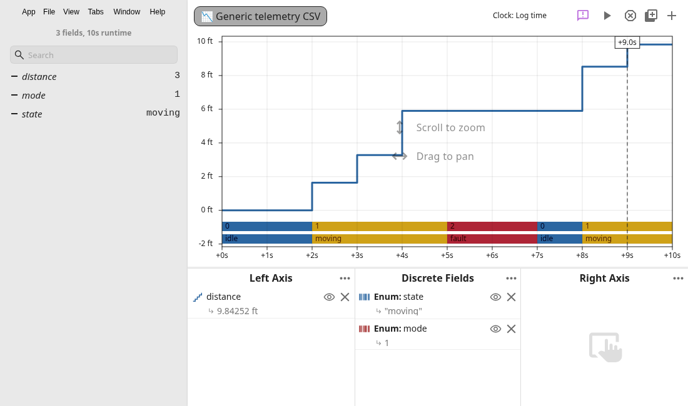

# Generic numeric and enum lanes

The screenshot uses [generic-telemetry.csv](generic-telemetry.csv), a CSV recording with no unit metadata. The string `state` and integer `mode` fields use Enum lanes. The `distance` field declares meters and displays feet.

The UI check saves the real tab layout, reloads it through `Tabs.restoreState`, and checks the converted numeric values. The saved layout and observed values are in [ui-verification.json](ui-verification.json). The original CSV values remain unchanged.

[checks.txt](checks.txt) contains command output for the dependency install, WASM build, compilation, tests, and format check. The dependency install uses the same optional video-download skip as CI and the cloud environment's proxy settings.

To reproduce the graph, open the CSV in TerraScope. Add `distance` to the left axis and select **Source Unit (when missing)**, then **meters** in its field menu. Select **feet** in the axis menu. Add `state` and `mode` to Discrete Fields and select **Enum** in each field menu.

Enum interpretation supports at most ten states in the available history. It leaves unsupported fields visible as ordinary stripes. The graph scans that history when preparing an enum lane, which can add work for long recordings. Existing lane defaults and layouts keep their behavior.

Skipped outside Cursor: deslop, Bugbot, and control-ui. These tools are unavailable here. Independent code and comment review, behavior tests, and the Electron screenshot cover this change.
