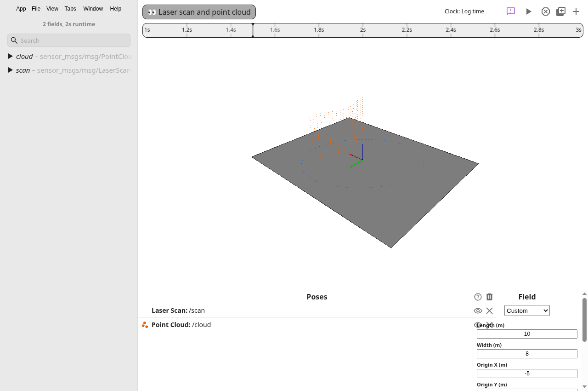

# Laser scans and point clouds

[spatial-sensors.png](spatial-sensors.png) shows the committed ROS 2 bag fixture in the app's existing 3D field view at 1.5 seconds. The blue points are `/scan`. The orange points are `/cloud`.

The fixture is [spatial-sensors.db3](../../../src/hub/dataSources/ros2/fixtures/spatial-sensors.db3). Regenerate it from the repository root with `python3 src/hub/dataSources/ros2/fixtures/generate-spatial.py`. The bag has samples at seconds 1 and 2, then empty messages at second 3. Both topics use meters and the same `sensor` frame.

To reproduce the view, open the fixture in TerraScope and select the 3D Field tab. Select **Custom** as the field. Set length to 10 meters, width to 8 meters, and origin to -5, -4. Drag `/scan` and `/cloud` from the sidebar into **Poses**. Select different colors and seek to 1.5 seconds.

[ui-verification.json](ui-verification.json) records the actual renderer's geometry at cursor times 1.5, 2.5, 3, and 1.5 seconds. The point counts are 181 and 441, then zero for both empty messages, then 181 and 441 after rewind. The first point moves at the second sample. Reloading the saved layout restores both sources.

[compatibility.json](compatibility.json) records a comparison against main commit `961bd09a`. An existing scene with axes, a cone, and a trajectory produces identical render commands. The 980 by 564 canvas has zero changed pixels between [main](existing-main.png) and [this branch](existing-updated.png). Both runs use Electron with SwiftShader and the same camera. The comparison asserts three trajectory poses and a valid identity quaternion before it compares images.

[checks.txt](checks.txt) contains output and exit codes for dependency installation, the Emscripten 4.0.12 build, compilation, all tests, and formatting. New tests cover semantic mapping, polar conversion, cloud fields and byte layouts, invalid values, downsampling, cursor selection, and the same CDR data through both readers. The bag test also checks worker serialization.

Points use the selected scene's coordinates. The view does not apply `frame_id` transforms, accumulate samples, or use level-of-detail. Each source has one display color. Per-point color and intensity are outside this change.

Skipped outside Cursor: deslop, Bugbot, and control-ui. Those tools are unavailable. Independent code and comment review, behavior tests, and the Electron checks cover this change. GitHub CLI is the fallback forge because Origin is unavailable.

[verify-scene.cjs](verify-scene.cjs) repeats the app checks through a local Chrome DevTools Protocol connection. Start the compiled app with `npm start -- --remote-debugging-port=9222`, then run `node docs/evidence/chunk-12/verify-scene.cjs sensors` from the repository root. It writes screenshots, cursor observations, and the saved layout under `build/spatial-scene`. Set `SCENE_PORT` to use another port and `SCENE_OUTPUT` to change the output directory.

To repeat the compatibility check, run the script in `baseline` mode against a main app and in `updated` mode against this branch, with the same output directory. Then run it in `compare` mode. The baseline for this PR is main commit `961bd09a`.
