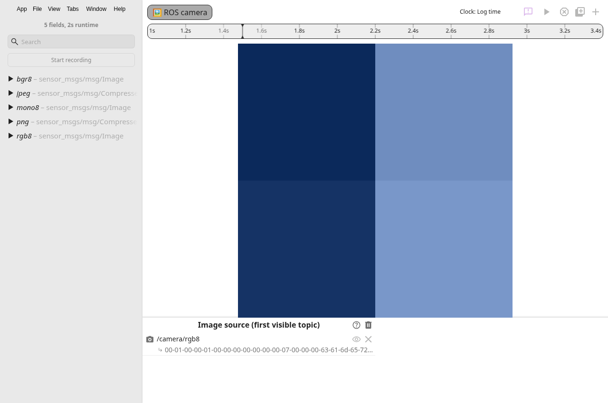

# Image frame follow-up verification

The screenshots come from Electron 39.2.7 under Xvfb display `:99`, with Node 22.23.4. The app opened the existing `images.db3` fixture through its ROS 2 bag reader. Its 2 by 2 rgb8 frames are enlarged with nearest-neighbor interpolation. The cursor changes from 1.5 to 2.5 seconds, and each RGB channel increases by one.

| Cursor and window        | Screenshot                                   |
| ------------------------ | -------------------------------------------- |
| Hub at 1.5 seconds       |    |
| Hub at 2.5 seconds       |    |
| Satellite at 2.5 seconds |  |

`verify-images.cjs` uses CDP `Page.captureScreenshot`. It compares canvas pixels with the fixture values, observes outgoing satellite messages, opens a second satellite, reloads the first, clears the source, and closes a populated Image tab. `ui-verification.json` records the observed pixels, command ids, title-only update, and encode count.

The baseline at `2b941d2d` produced this output with `IMAGE_BASELINE=1`.

```text
REPRO: idle updates=8; empty ID changed=true; PNG encodes=2.
```

The fixed app produced this output.

```text
PASS: two cursor frames, actual satellite pixels, idle and empty dedupe, title-only update, second satellite, reload, source clear, tab close, and zero PNG encodes.
```

Run the verification after compiling and installing Xvfb. Start Xvfb in one terminal and Electron in another.

```sh
Xvfb :99 -screen 0 1600x1000x24 &
DISPLAY=:99 XDG_CONFIG_HOME=/tmp/ts/config XDG_DATA_HOME=/tmp/ts/data XDG_CACHE_HOME=/tmp/ts/cache npm start -- --no-sandbox --disable-gpu --remote-debugging-port=9222
```

Then run the script from the repository root. It closes existing satellite windows in this test instance and restores an Image layout. Set `IMAGE_OUTPUT` to save the captures elsewhere.

```sh
node docs/evidence/chunk-13/verify-images.cjs
```

Node 22 checks passed with Emscripten 4.0.12. `npm ci`, `npm run wasm:compile`, `npm run compile`, `npm test`, and `npm run check-format` each exited 0. The full suite passed 175 tests. New headless tests cover controller identity, outgoing satellite updates, actual Electron and Lite dispatch, raw-image endianness, canvas pixels, and resource release.
