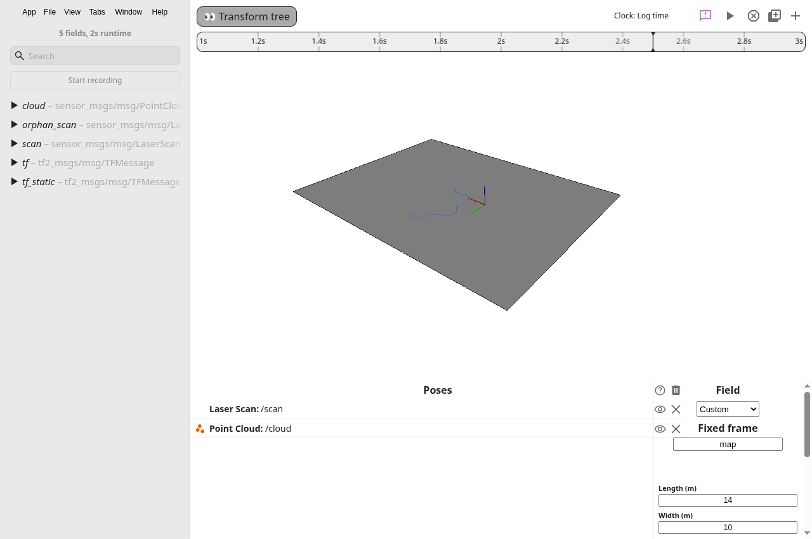
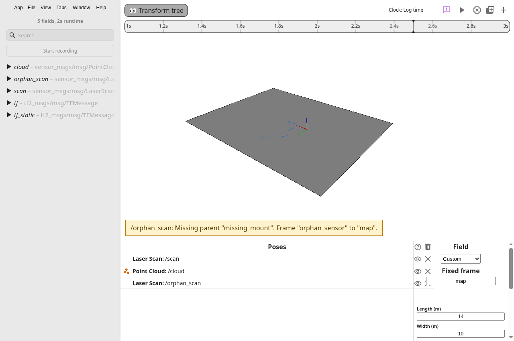

# Transform tree verification

The committed [fixture](../../../src/hub/dataSources/ros2/fixtures/transform-tree.db3) has `/tf_static` edges from `base` to `laser` and from `missing_mount` to `orphan_sensor`. Its `/tf` messages move `base` relative to `map`. `/scan` and `/cloud` each publish once in `laser`, so the cursor changes their placement without changing their local geometry. `/orphan_scan` names the disconnected `orphan_sensor` frame.

Regenerate the fixture with `python3 src/hub/dataSources/ros2/fixtures/generate-transforms.py`. The generator uses the Python standard library. Reader tests load the bag and wrap the same CDR samples in MCAP, then verify frame lookup through both readers and worker serialization.

## Cursor placement

The scan has 91 points. The cloud has three. At cursor 1.5, the laser pose is `[-1.5, -1, 0.25]` with identity rotation. At cursor 2.5, its pose is `[2, 1.5, 0.25]` with a 90-degree yaw. The first scan point moves from `[0, -1, 0.25]` to `[2, 3, 0.25]` in the fixed `map` frame.

The third capture adds `/orphan_scan`. The indicator names `missing_mount`, the source frame, and the fixed frame. The failed source contributes no points at the origin.

[observations.json](observations.json) records the actual renderer's point counts, local points, positions, quaternions, world matrices, commands, and diagnostic text. The script checks both cursor placements, unchanged local geometry, rewind, fixed-frame layout restoration, and a framed Pose3d source. It also checks framed vision targets, components, rotation overrides, and suppression before a source's first sample.

The frameless scene comparison against main commit `db342597` uses axes, a cone, and a trajectory. Its prepared commands match exactly. The canvas comparison reports zero changed pixels. [compatibility.json](compatibility.json) records the result. The [main canvas](existing-main.png) and [updated canvas](existing-updated.png) use the same camera and SwiftShader settings. Repeat the comparison with `docs/evidence/chunk-12/verify-scene.cjs` in `baseline`, `updated`, and `compare` modes, with a shared `SCENE_OUTPUT` directory.

## Lookup rules

Dynamic transforms use the last sample at or before the cursor in the log's display clock. Static transforms apply throughout the recording, using the last static definition for each child. ROS header timestamps remain logged metadata. This chunk does not interpolate transforms or assume that header clocks match the timeline.

The **Fixed frame** setting is saved in the layout. An empty setting chooses an observed `map`, `odom`, or `world`, then a unique root. An ambiguous graph requires a selection. Lookup supports connected reference frames through a common ancestor. Missing links, unavailable dynamic samples, invalid transforms, and cycles suppress affected geometry and produce a diagnostic. Separate recording and live-source namespaces keep identical frame names apart.

Frame ids come from a source's `header/frame_id` at its selected sample. Sources without that field retain their previous scene coordinates. No WPILib frame names are inferred.

## Repeat the app check

Compile the app, then start it with `npm start -- --remote-debugging-port=9222`. Run `node docs/evidence/chunk-14/verify-transform-tree.cjs`. The script opens the real fixture through the app's file-open path. It writes captures and observations under `build/transform-tree`. Set `SCENE_PORT` or `SCENE_OUTPUT` to change the local DevTools port or output directory.

This run used a virtual Xorg display and Electron's SwiftShader renderer. [checks.txt](checks.txt) contains the done-check output and UI verification output.

## Workflow

After rebasing onto main commit `284eb0d2`, [rebase-checks.txt](rebase-checks.txt) records fresh compilation, all 133 tests, formatting, and preservation checks against both branch heads. The test command includes both the frame tests and chunk 18's registry and reader-fixture tests. The reader inventory and field baseline now include the transform bag. Every previous fixture baseline is unchanged. PLAN.md and ROADMAP.md retain both chunks' completed work.

The Feature playbook used two independent read-only designs and a separate design review. Both chose a semantic child-keyed graph over the existing decoded log fields. One implementation owner changed the graph, scene integration, tests, and fixture. The root agent owned app checks, documentation, and final review. Shared writes stayed separate.

Model the Domain led to child-keyed transform histories and typed resolution failures. Build the Lever led to the fixture generator and repeatable app check. Prove It Works required real renderer observations and screenshots. Sequence Work into Verifiable Units separated implementation checks from final evidence and documentation.

Skipped outside Cursor: deslop, Bugbot, and control-ui. These tools are unavailable. Independent code and comment review and the Electron check cover this change. GitHub CLI is the fallback forge because Origin is unavailable. PR creation uses the provided GitHub tool.
