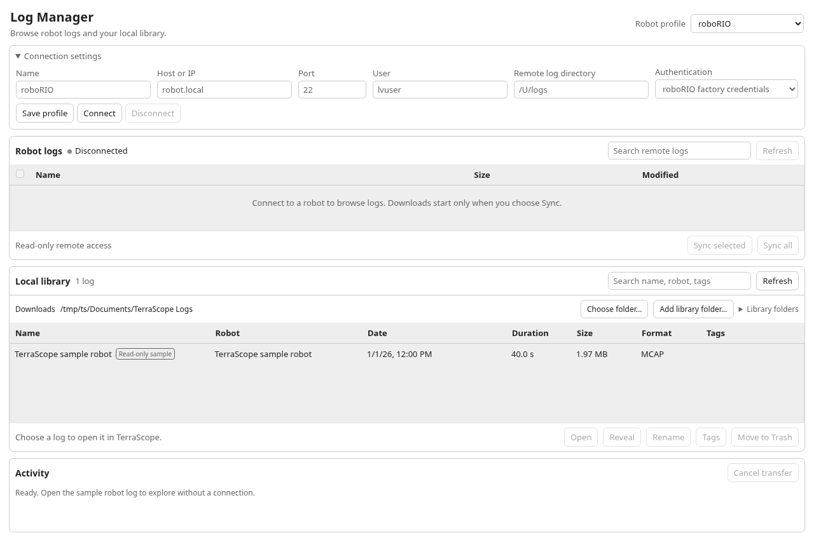
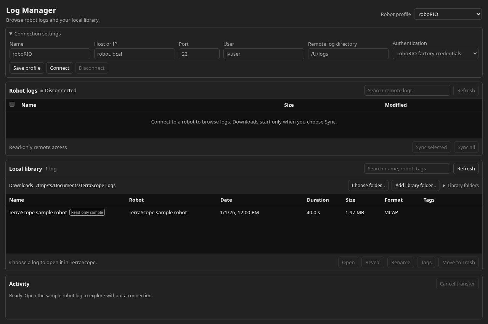
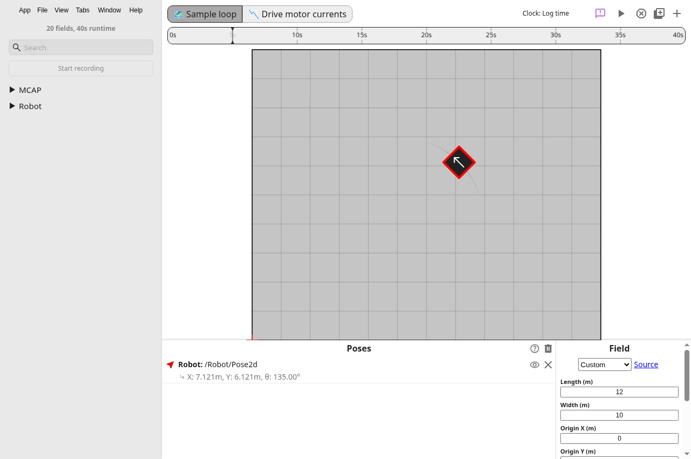
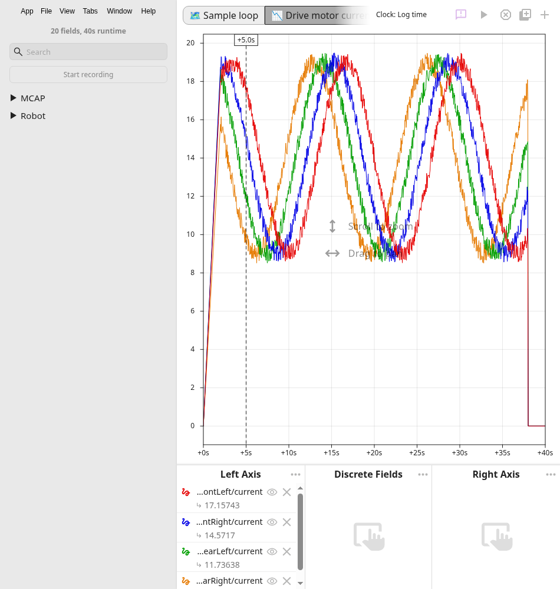
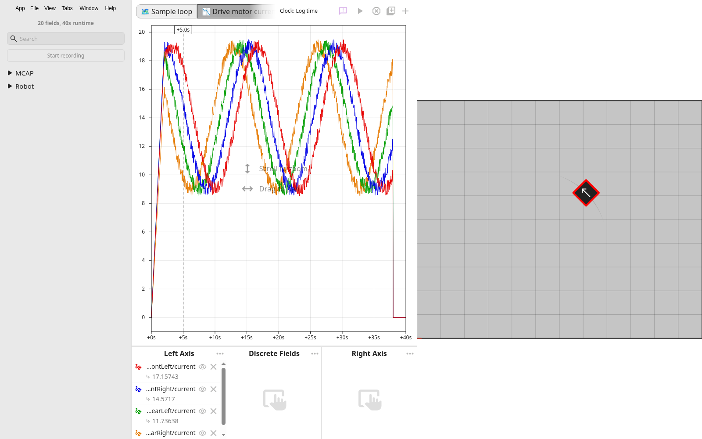
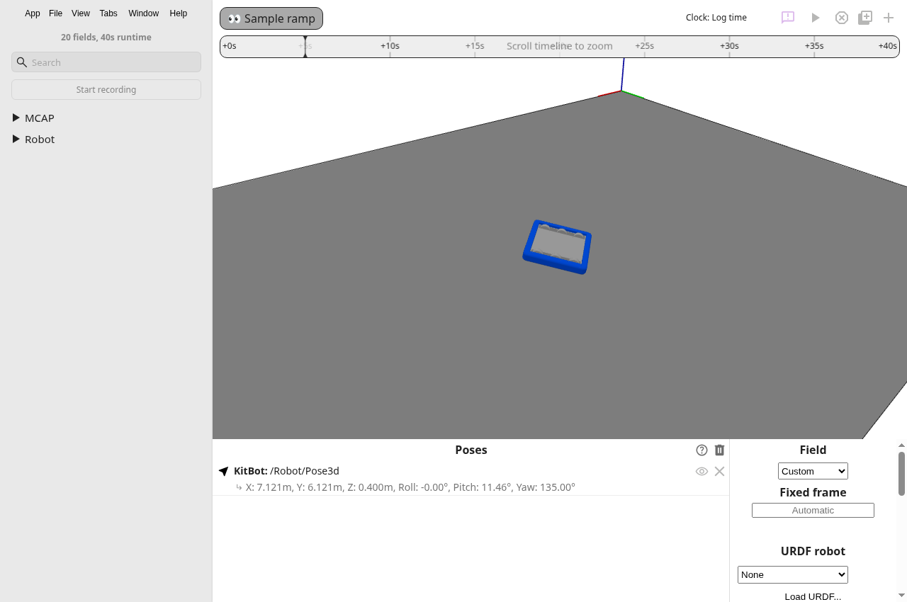
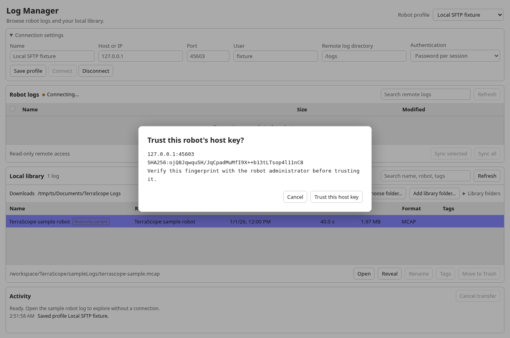
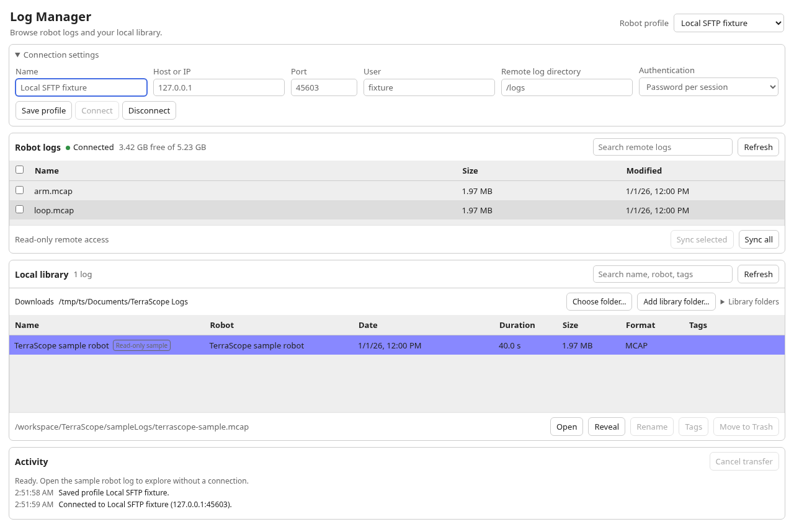
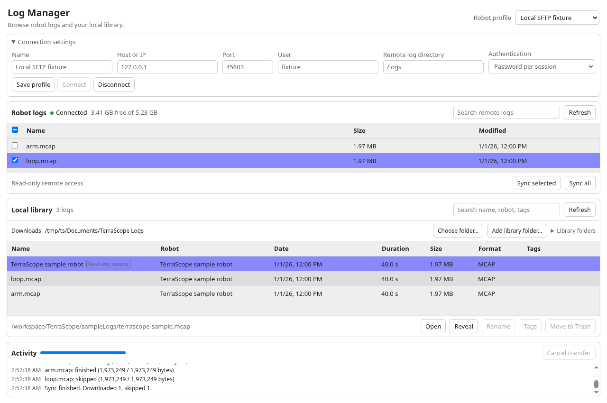

# Log Manager verification

TerraScope v0.2 item B adds the desktop Log Manager. The app uses the existing reader registry, existing in-app open path, and TerraScope's light and dark styles. The existing Download Logs implementation is unchanged.

## Run the app check

Use Node 22 and Emscripten 4.0.12. Install dependencies, then run `npm run wasm:compile` and `npm run compile`.

Create a fresh test profile and start the app in Xvfb.

```sh
mkdir -p /tmp/ts/config /tmp/ts/data /tmp/ts/cache /tmp/ts/Documents
cat > /tmp/ts/config/user-dirs.dirs <<'DIRS'
XDG_DOCUMENTS_DIR="/tmp/ts/Documents"
DIRS
Xvfb :99 -screen 0 1600x1000x24 &
DISPLAY=:99 XDG_CONFIG_HOME=/tmp/ts/config XDG_DATA_HOME=/tmp/ts/data XDG_CACHE_HOME=/tmp/ts/cache npm start -- --no-sandbox --disable-gpu --remote-debugging-port=9222 --inspect=9229
```

In another terminal, run the committed check.

```sh
node docs/evidence/v02-log-manager/verify.cjs
```

The script starts its own throwaway SSH/SFTP server on `127.0.0.1`. It opens Log Manager through the File menu accelerator, opens the sample with real double-click input, configures field and graph tabs through their saved-layout APIs, and captures actual app windows with CDP. The combined field-and-graph image captures the actual X desktop with a 2D satellite beside the hub. It is not an image composite. The script requires Python Pillow for that capture. No physical robot is accessed.

The server exposes a supported MCAP pair and an unsupported text file. Its remote mutation handlers fail the check if invoked. The check covers first trust, list filtering, disk usage, selected sync, full sync with a duplicate, byte equality, repeat skipping without content reads, temporary-file cleanup, and changed-key refusal with both fingerprints. The profile file is checked for secret fields and the fixture password.

Use a fresh profile and empty test download folder for each full run. Reusing an earlier profile intentionally retains missing files, profiles, and host trust. The fixture generates a fresh host key on every run.

## Results

- Node `v22.23.4`.
- `npm run wasm:compile` and `npm run compile` pass.
- `npm test` passes 327 tests across its eight test invocations.
- The sample is 1,973,249 bytes. Regeneration produces the same SHA256, `794991ad781f1d60ac105faf71a4797d254a613f0c59f13595fa338bdb34958e`.
- `npm ci` installs the dependencies and reaches the existing Owlet download step, then fails because the environment's proxy denies `https://redist.ctr-electronics.com` with HTTP 403. This is an incomplete done-check. No lifecycle scripts were skipped and no dependency versions were changed to hide the failure.

Full command output is saved in [npm-ci.txt](npm-ci.txt), [wasm-compile.txt](wasm-compile.txt), [compile.txt](compile.txt), [test.txt](test.txt), and [sample.txt](sample.txt). The final formatter output is in [format.txt](format.txt). The app check output is in [ui.txt](ui.txt), with inspected values in [observations.json](observations.json). The setup attempts and toolchain version are in [environment.txt](environment.txt). Decisions are recorded in [decisions.tsv](decisions.tsv).

The ordinary regression suite ran. Compatibility and replay verification remain deferred. No rebrand or Lite feature work is included.

## Screenshots

A fresh profile lists the read-only sample without connecting to a robot.



The same window honors dark mode.



The sample's 2D pose and four drive-motor current series render in TerraScope.







The Pose3d sample includes height and pitch on the ramp.



Connecting to the local fixture requires explicit host-key trust.



The fixture lists only supported files and reports disk usage.



Sync completes through the real window and records progress and skipped files.


