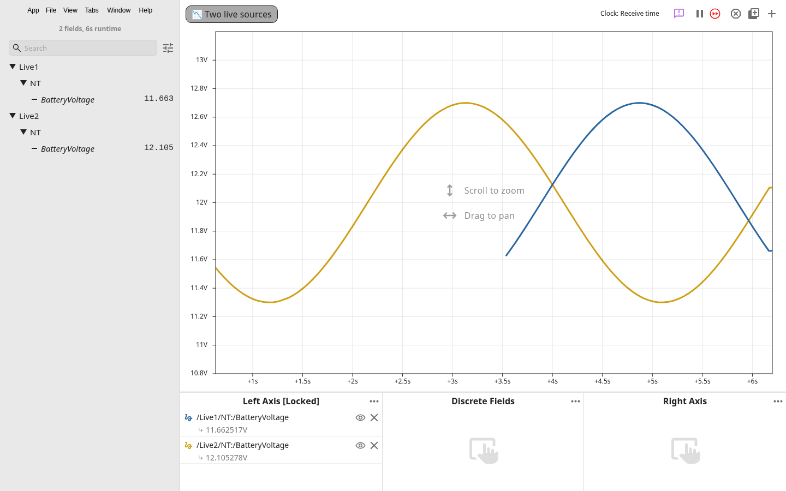
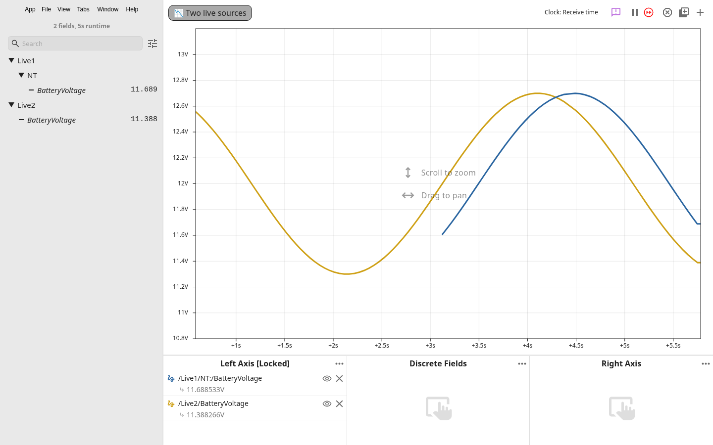

# Verify two live sources

Install the locked dependencies and compile the app before starting it with a local debugging port.

```sh
npm ci
npm run wasm:compile
npm run compile
npm start -- --remote-debugging-port=9222
```

In a headless Linux container, start Xvfb and set `DISPLAY`. Add `--no-sandbox --disable-gpu` if the container requires those Electron flags.

Run the fixture check from the repository root. The first command connects two NetworkTables servers. The second connects NetworkTables and Foxglove.

```sh
node scripts/verify-multiple-live-sources.cjs --screenshot=/tmp/multiple-live-sources.png
node scripts/verify-multiple-live-sources.cjs --mixed --screenshot=/tmp/mixed-live-sources.png
```

The script starts local fixture servers, connects through the hub's main-message receiver, and configures the existing line graph through its saved-state API. Both servers publish `/BatteryVoltage` with changing values and unrelated clock origins. The checks cover legacy single-source keys, namespace separation, low-bandwidth subscriptions, original timestamp domains, and peer sample growth during a disconnect and reconnect.

Set `CDP_PORT` if the app uses a debugging port other than 9222. The default fixture ports are 5810 on `127.0.0.1` and `127.0.0.2` for NetworkTables, and 8765 on `127.0.0.1` for Foxglove.

The [command output](commands.txt) records the done-check and fixture runs. The [post-rebase output](rebase-commands.txt) records compilation, formatting, and the combined chunk 10 and chunk 11 test suites after rebasing onto main. Receive-estimated alignment places both traces on one display timeline. It does not measure synchronization quality or correct clock drift.




