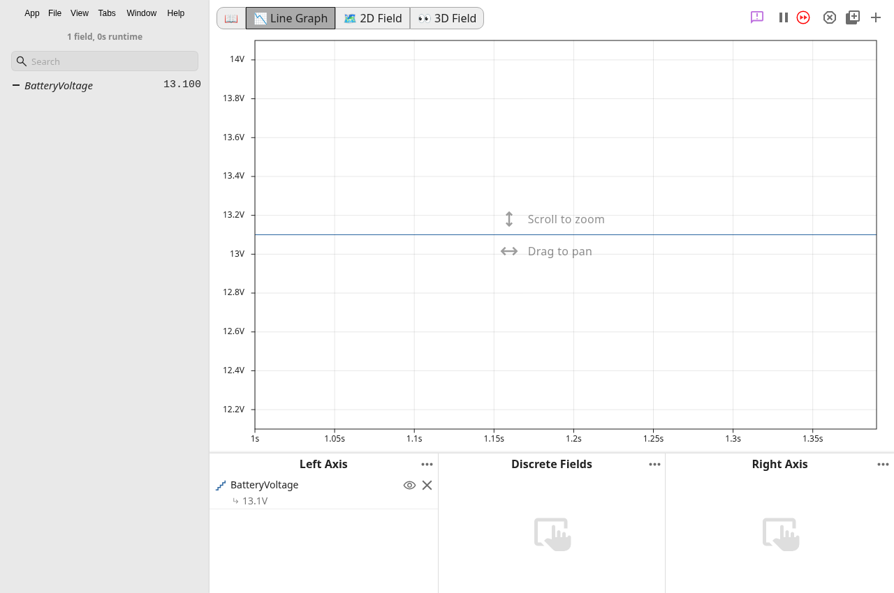
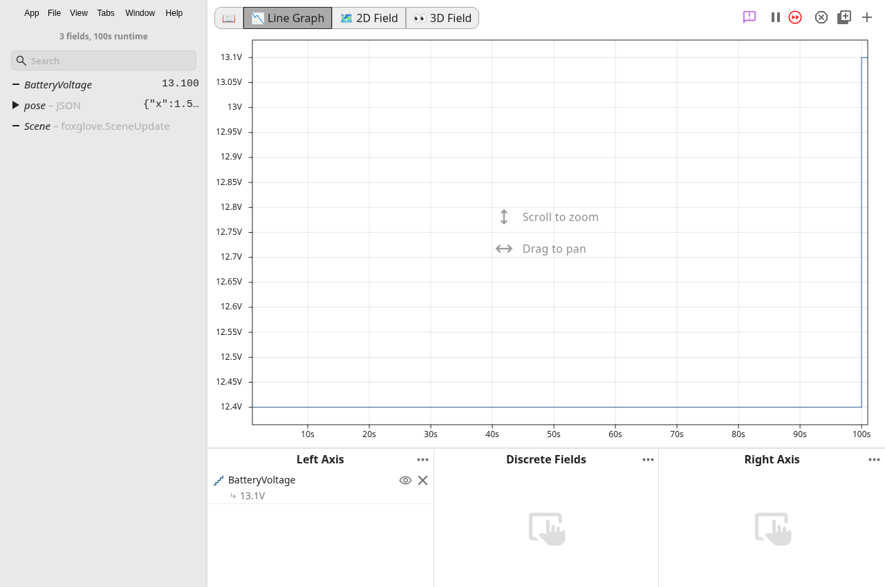

# Live transport verification

Chunk 7 separates framed socket delivery from telemetry decoding. The same local fixture harness passed before and after the refactor.

The RLOG check uses the production TCP connection, main-process framing, IPC, and RLOG decoder. It sends fragmented headers and coalesced frames. The Foxglove check negotiates subscriptions and sends JSON and raw binary payloads through the production live source. Both checks restart their servers and require a fresh voltage value to prove reconnection.

The [command output](commands.txt) records the done-check results. The screenshots show the running app after each fixture restarts.





## Repeat the app check

From the repository root, run `npm test` to compile the fixture server and `npm run compile` to build the app. Start the app with DevTools enabled.

```sh
npm start -- --remote-debugging-port=9222
```

For a headless cloud container, start an X server and set `DISPLAY`. The verification used Xvfb on display `:99` and this command.

```sh
DISPLAY=:99 XDG_CONFIG_HOME=/workspace/chunk7-runtime/config XDG_DATA_HOME=/workspace/chunk7-runtime/data XDG_CACHE_HOME=/workspace/.cache npm start -- --no-sandbox --disable-gpu --remote-debugging-port=9222
```

Run the harness in another shell.

```sh
node docs/verification/chunk-7/live-smoke.cjs
```

The harness starts loopback fixture servers, selects each source through the hub's existing message-port handler, and checks the renderer's actual log fields. It changes only in-memory connection preferences. It saves screenshots and JSON results in `build/live-transport-smoke` and closes its fixture servers afterward.

RLOG must decode `BatteryVoltage=12.4`, then receive `13.1` after reconnecting. Foxglove must decode `BatteryVoltage=12.4`, `pose/x=1.5`, `pose/y=2.5`, and raw `Scene` data with type `foxglove.SceneUpdate`, then receive `13.1` after reconnecting.

## Scope

NetworkTables, telemetry decoders, and available live modes are unchanged. RLOG framing rejects negative lengths, suppresses stale socket events, and reports one failure per disconnect. These checks use local fixture servers; physical robot connections are not covered.
