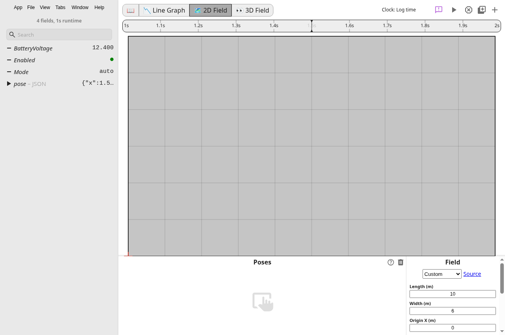

# Timestamp compatibility verification

`clock-smoke.cjs` opens WPILOG, RLOG, MCAP, CSV, and JSON files in the running Electron app. It uses the hub's file-open handler, the main-process file read, and the production historical workers. Selecting `BatteryVoltage` on the line graph also exercises WPILOG's lazy field decode.

Every fixture contains `BatteryVoltage` values `12.4` and `12.8` at timestamps `1` and `2` seconds. MCAP and JSON reuse the reader test fixtures. The script creates WPILOG with `WPILOGEncoder` and creates RLOG with the revision 2 record layout used by the live transport fixture.

The script compares all loaded fields, values, and timestamps with `baseline-results.json`, captured from a fresh main build at `65c5bb3ef813b2e553da04104bf2d4270c0ce492`. It also checks the playback clock-domain label and saves graph and timeline screenshots for each format. The timeline screenshot uses the 2D tab, since the line graph has its own time axis and hides the shared timeline.

After those comparisons, the final run opens the ROS 2 bag fixture to verify the bundled sql.js runtime. The build excludes that generated runtime from comment cleanup because the cleanup scanner stalls on its minified JavaScript.

## Repeat the check

Run `npm ci`, `npm run compile`, and `npm run wasm:compile`. Start the app with its debugging port enabled.

```sh
npm start -- --remote-debugging-port=9222
```

For a headless Linux container, start Xvfb and set `DISPLAY`. Add `--no-sandbox --disable-gpu` when the container requires those Electron flags.

Run the check from the repository root.

```sh
node docs/verification/chunk-9/clock-smoke.cjs
```

The default output directory is `build/clock-smoke`. An optional directory argument changes that location. The output includes `results.json`, screenshots, and generated fixture files.

The [command output](commands.txt) records the done-check and app comparison. The checked-in timeline screenshot shows the active log clock after JSON import.



## Clock behavior

Each log has one display clock. Tagged samples retain their original timestamp and require an explicit conversion when their clock differs. Legacy numeric samples keep their existing display coordinates. Their source query reports that display domain as a fallback, including after trimming or alignment.

NetworkTables retains server sample timestamps. Its latency adjustment applies only to the live cursor through the named receive-to-server conversion. Clock selection in the UI, drift correction, and domain metadata in exported files remain outside this chunk.

To capture a fresh baseline, start an unchanged main build and run the script with `--baseline`. That mode writes `baseline-results.json` beside the script and does not require the new clock label.

```sh
node docs/verification/chunk-9/clock-smoke.cjs /tmp/clock-baseline --baseline
```
